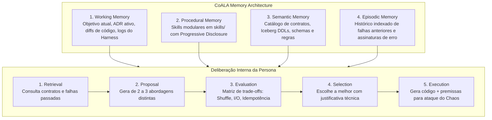
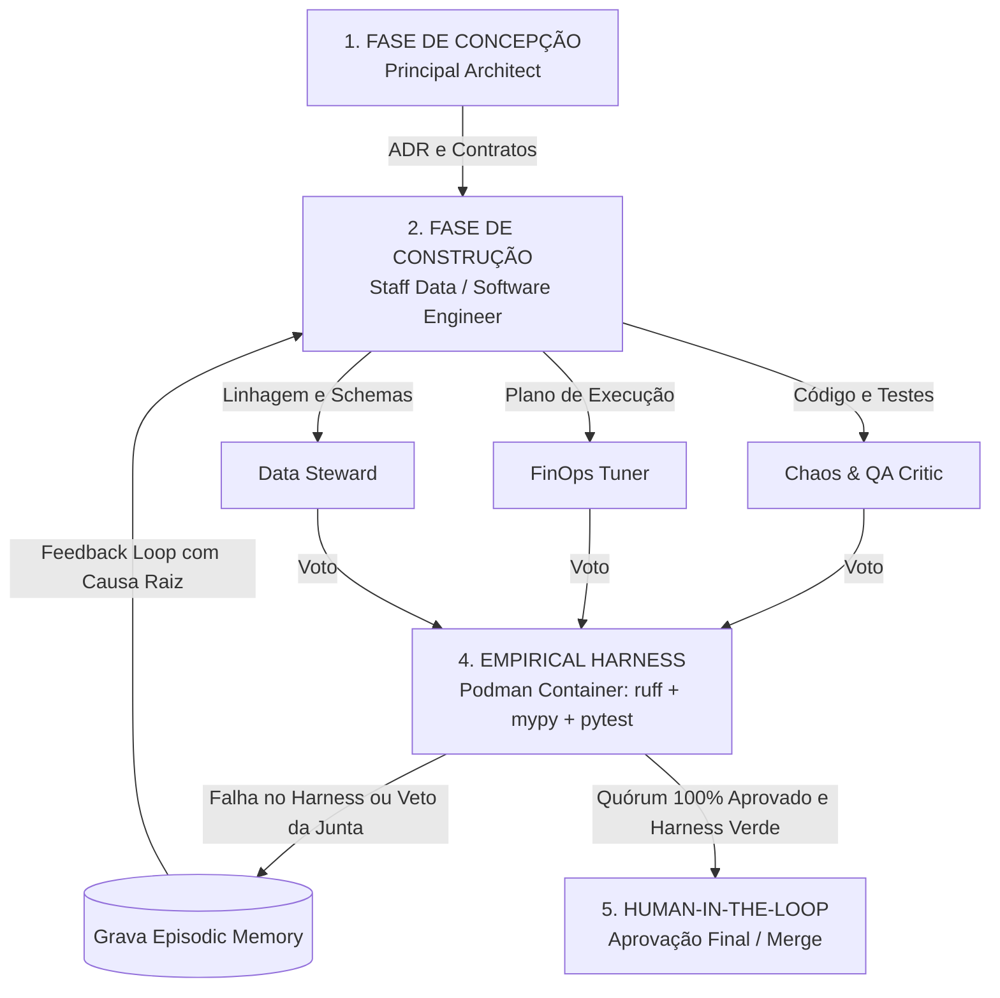

<div align="center">


# cortex-squad-ai

**Plataforma Agêntica Multi-Persona para Engenharia de Dados & Software de Missão Crítica**

[](https://www.python.org/downloads/)
[](#2-arquitetura-hexagonal--solid)
[](#3-arquitetura-cognitiva-coala)
[](#4-máquina-de-estados--orquestração-langgraph)
[](#5-test-harness-empírico--pirâmide-de-testes)
[](#8-guia-de-instalação--execução)

</div>

---

## Índice Modular

- [1. Visão Geral & Proposta de Valor](#1-visão-geral--proposta-de-valor)
- [2. Arquitetura Hexagonal & SOLID](#2-arquitetura-hexagonal--solid)
- [3. Arquitetura Cognitiva CoALA](#3-arquitetura-cognitiva-coala)
- [4. As 6 Personas & Poderes de Veto](#4-as-6-personas--poderes-de-veto)
- [5. Máquina de Estados & Orquestração (LangGraph)](#5-máquina-de-estados--orquestração-langgraph)
- [6. Test Harness Empírico & Pirâmide de Testes](#6-test-harness-empírico--pirâmide-de-testes)
- [7. Estrutura Modular do Projeto](#7-estrutura-modular-do-projeto)
- [8. Guia de Instalação & Execução](#8-guia-de-instalação--execução)
- [9. Interfaces de Entrada (CLI & FastMCP Server)](#9-interfaces-de-entrada-cli--fastmcp-server)

---

## 1. Visão Geral & Proposta de Valor

O **cortex-squad-ai** substitui interações monolíticas e superficiais de LLMs por uma **squad autônoma especializada de alta performance**, inspirada na metodologia de squads multidisciplinares e fundamentada formalmente no framework **CoALA (Cognitive Architectures for Language Agents)** e na máquina de estados **LangGraph**.

### Problemas comuns em agentes tradicionais vs Solução Cortex Squad:

| Desafio Típico | Abordagem Convencional | Solução no Cortex Squad |
| :--- | :--- | :--- |
| **Alucinação em Código** | O LLM afirma que testou o código. | **Empirical Harness**: Nenhuma aprovação ocorre sem validação determinística de testes em contêiner isolado (*Podman*). |
| **Looping de Erros** | O agente comete o mesmo erro repetidamente. | **Memória Episódica**: Falhas e causas raízes são indexadas e injetadas como restrições no próximo ciclo. |
| **Context Rot / Degradação de Atenção** | Injeção de prompts gigantescos com todas as regras. | **Progressive Disclosure**: As skills são descarregadas em 3 níveis (L1 Metadados -> L2 Instruções -> L3 Scripts). |
| **Violações de Governança e Custos** | Código funcional, mas vazando PII ou ineficiente. | **Junta Crítica com Poder de Veto**: *Data Steward* e *Chaos QA* bloqueiam merges que violem LGPD ou resiliência. |

---

## 2. Arquitetura Hexagonal & SOLID

O núcleo da aplicação obedece estritamente ao desacoplamento **Ports & Adapters**, assegurando que regras cognitivas e de quórum sejam 100% agnósticas a bibliotecas de LLM, bancos vetoriais ou orquestradores.

```
                          ┌──────────────────────────────────────┐
                          │         ADAPTERS (INBOUND)           │
                          │   CLI (Typer/Rich) • FastMCP Server  │
                          └──────────────────┬───────────────────┘
                                             │
                                             ▼
                          ┌──────────────────────────────────────┐
                          │          APPLICATION LAYER           │
                          │   Use Cases: RunMission, CoALAStep   │
                          │   Ports: LLMPort, MemoryPort, ...    │
                          └──────────┬───────────────────────────┘
                                     │ (Zero Imports de Frameworks)
                                     ▼
                          ┌──────────────────────────────────────┐
                          │             DOMAIN CORE              │
                          │   Entities: PersonaSpec, Memories    │
                          │   Services: QuorumPolicy, Router     │
                          └──────────┬───────────────────────────┘
                                     │
                                     ▼
                          ┌──────────────────────────────────────┐
                          │         ADAPTERS (OUTBOUND)          │
                          │ LangGraph • LiteLLM • SQLite • Podman│
                          └──────────────────────────────────────┘
```

- **Domain (`src/cortex_squad/domain/`)**: Pureza total em Python. Entidades imutáveis (`frozen=True`) como `CoALAMemoryContext`, `PersonaSpec`, `SquadDecision`, `HarnessReport` e regras de quórum (`QuorumPolicy`).
- **Application (`src/cortex_squad/application/`)**: Orquestração via Use Cases e contratos baseados em `typing.Protocol` (`LLMPort`, `MemoryStorePort`, `SkillLoaderPort`, `SandboxExecutorPort`, `ReadOnlyWorkspacePort`, `WorkspaceMutationPort`).
- **Adapters (`src/cortex_squad/adapters/`)**: Conexões concretas com CLI, FastMCP, SQLite, LiteLLM, Podman e LangGraph.

---

## 3. Arquitetura Cognitiva CoALA

Cada membro da squad opera sobre 4 camadas estritas de memória:



### Progressive Disclosure de Conhecimento (Agent Skills)
- **Nível 1 (L1 - Metadados):** Frontmatter YAML (`name`, `persona`, `role_type`, `triggers`, `veto_power`). Ocupa ~100 tokens.
- **Nível 2 (L2 - Instruções):** Corpo do `SKILL.md` carregado sob demanda apenas para a persona ativa.
- **Nível 3 (L3 - Recursos & Scripts):** Diretórios `references/`, `checklists/` e `scripts/` carregados para validações aprofundadas.

---

## 4. As 6 Personas & Poderes de Veto

| Persona | Papel | Veto | Escopo Principal |
| :--- | :--- | :---: | :--- |
| **Principal Architect** | `conceptualizer` | **SIM** | Define ADRs, contratos de interface e topologia de componentes. |
| **Staff Data Engineer** | `builder` | NÃO | Pipelines distribuídos, tabelas Apache Iceberg, idempotência e PySpark. |
| **Staff Software Engineer** | `builder` | NÃO | APIs assíncronas, Clean Architecture, Pydantic e robustez de código. |
| **Chaos & QA Critic** | `critic` | **SIM** | Injeta anomalias (nulls, schema drift, skew) e exige testes verdes no harness. |
| **FinOps & Perf Tuner** | `critic` | **SIM** | Bloqueia Cartesian Products, shuffle spill excessivo e custos abusivos de DPU. |
| **Data Steward** | `auditor` | **SIM** | Bloqueia exposição de dados sensíveis (PII) e assegura conformidade LGPD. |

---

## 5. Máquina de Estados & Orquestração (LangGraph)

O fluxo da squad é governado por um grafo cíclico resiliente:



---

## 6. Test Harness Empírico & Pirâmide de Testes

Nenhuma entrega é aprovada unicamente com base em texto gerado por LLMs. O `PodmanHarnessRunner` executa verificações concretas:

1. **Validação Estática & Tipagem**: `ruff check .` e `mypy --strict src` (garantindo zero erros de tipagem estrita).
2. **Contratos & Testes Unitários**: Execução isolada via `pytest` com geração de massas sintéticas.
3. **Chaos Probes**: Injeção determinística de anomalias para validação de resiliência.
4. **Integridade de Skills**: Testes automáticos garantindo integridade de frontmatter YAML e arquivos referenciados em `skills/`.

---

## 7. Estrutura Modular do Projeto

```
cortex-squad-ai/
├── pyproject.toml                     # Gerenciamento via uv, ruff, mypy strict, pytest
├── Containerfile                      # Contêiner isolado rootless para o Test Harness
├── docker-compose.yml                 # Suporte a Postgres, MinIO e Ollama
│
├── skills/                            # CAMADA DE CONHECIMENTO PROCEDURAL (Progressive Disclosure)
│   ├── _shared/                       # Protocolos transversais (cognitive-loop, handoff)
│   ├── principal-architect/           # SKILL.md, checklists e templates de ADR
│   ├── staff-data-engineer/           # SKILL.md, referências Iceberg e script explain_plan_check.py
│   ├── staff-software-engineer/       # SKILL.md e referências Clean Arch
│   ├── chaos-qa-critic/               # SKILL.md e script mutation_probe.py
│   ├── finops-tuner/                  # SKILL.md e referências AWS Glue/EMR cost
│   └── data-steward/                  # SKILL.md e checklist de governança LGPD
│
├── src/cortex_squad/
│   ├── domain/                        # Entidades puras, quórum e roteador de skills
│   ├── application/                   # Use Cases e Interfaces de Ports
│   └── adapters/                      # Inbound (CLI, MCP) e Outbound (LangGraph, LiteLLM, SQLite, Podman)
│
└── tests/                             # Pirâmide de Testes
    ├── unit/                          # Testes de domínio e integridade de skills
    ├── integration/                   # Testes de adapters (SQLite, etc.)
    └── e2e_harness/                   # Cenários E2E de convergência multi-agente
```

---

## 8. Guia de Instalação & Execução

### Pré-requisitos
- Python 3.11+
- [uv](https://github.com/astral-sh/uv) (recomendado) ou pip
- [Podman](https://podman.io/) (opcional, para execução de sandbox isolado)

### Passo a Passo

```bash
# 1. Clonar repositório
git clone https://github.com/seu-usuario/cortex-squad-ai.git
cd cortex-squad-ai

# 2. Criar ambiente virtual e instalar dependências
uv venv
source .venv/bin/activate
uv pip install -e ".[dev,mcp]"

# 3. Executar pirâmide de testes completa
pytest -v

# 4. Validar tipagem e linter
ruff check .
mypy --strict src
```

---

## 9. Interfaces de Entrada (CLI & FastMCP Server)

### 9.1. Interface CLI (Typer + Rich)

```bash
# Listar todas as personas e triggers reconhecidos (L1 Disclosure)
cortex-squad skills

# Executar uma missão de engenharia
cortex-squad run --mission "Implementar ingestão CDC em Apache Iceberg com idempotência" --max-cycles 3
```

### 9.2. Servidor FastMCP (Agentic IDEs / Antigravity / Claude Code)

O Cortex Squad expõe suas ferramentas diretamente para ambientes compatíveis com MCP:

```bash
python -m cortex_squad.adapters.inbound.mcp.server
```

**Ferramentas MCP disponíveis:**
- `run_mission(goal, workspace_path, max_cycles)`: Dispara a orquestração completa da squad autônoma.
- `list_squad_skills()`: Inspeciona as personas registradas e suas capacidades cognitivas.
