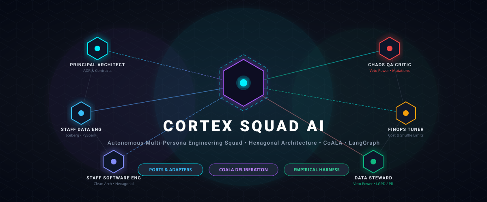
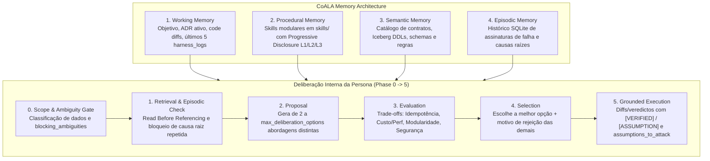
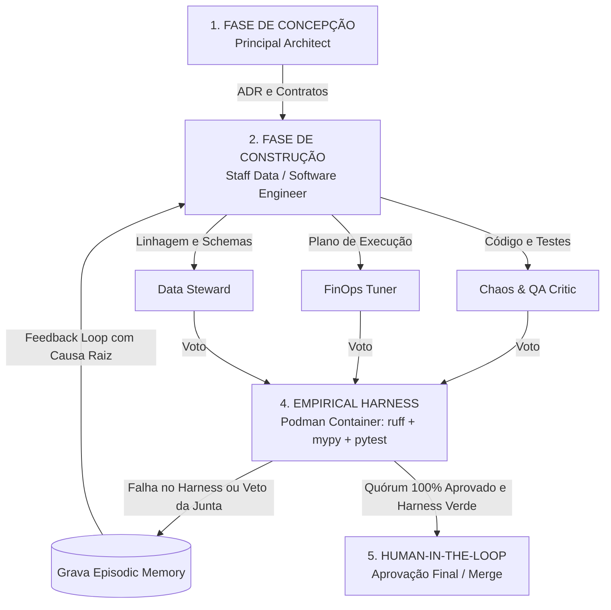

<div align="center">



# cortex-squad-ai

**Plataforma Agêntica Multi-Persona para Engenharia de Dados & Software de Missão Crítica**

[](https://www.python.org/downloads/)
[](#2-arquitetura-hexagonal--solid)
[](#3-arquitetura-cognitiva-coala)
[](CORTEX_SQUAD_SKILLS.md)
[](#5-máquina-de-estados--orquestração-langgraph)
[](#6-test-harness-empírico--pirâmide-de-testes)
[](#11-guia-de-instalação--execução)

</div>

---

## Índice Modular

- [1. Visão Geral & Proposta de Valor](#1-visão-geral--proposta-de-valor)
- [2. Arquitetura Hexagonal & SOLID](#2-arquitetura-hexagonal--solid)
- [3. Arquitetura Cognitiva CoALA](#3-arquitetura-cognitiva-coala)
- [4. As 6 Personas, Matriz RACI & Poderes de Veto](#4-as-6-personas-matriz-raci--poderes-de-veto)
- [5. Máquina de Estados & Orquestração (LangGraph)](#5-máquina-de-estados--orquestração-langgraph)
- [6. Test Harness Empírico & Pirâmide de Testes](#6-test-harness-empírico--pirâmide-de-testes)
- [7. Suite Consolidada CORTEX_SQUAD_SKILLS.md (Portabilidade Ctrl+C)](#7-suite-consolidada-cortex_squad_skillsmd-portabilidade-ctrlc)
- [8. A Inspiração por Trás de Cada Camada & Skill](#8-a-inspiração-por-trás-de-cada-camada--skill)
- [9. Histórico & Evolução de Cada Componente (v1.0.0 -> v2.0.0)](#9-histórico--evolução-de-cada-componente-v100---v200)
- [10. Estrutura Modular do Projeto](#10-estrutura-modular-do-projeto)
- [11. Guia de Instalação & Execução](#11-guia-de-instalação--execução)
- [12. Interfaces de Entrada (CLI & FastMCP Server)](#12-interfaces-de-entrada-cli--fastmcp-server)

---

## 1. Visão Geral & Proposta de Valor

O **cortex-squad-ai** substitui interações monolíticas e superficiais de LLMs por uma **squad autônoma especializada de alta performance**, inspirada na metodologia de squads multidisciplinares e fundamentada formalmente no framework **CoALA (Cognitive Architectures for Language Agents)** e na máquina de estados **LangGraph**.

### Problemas comuns em agentes tradicionais vs Solução Cortex Squad:

| Desafio Típico | Abordagem Convencional | Solução no Cortex Squad |
| :--- | :--- | :--- |
| **Alucinação em Código** | O LLM afirma que testou o código. | **Empirical Harness**: Nenhuma aprovação ocorre sem validação determinística de testes em contêiner isolado (*Podman*). |
| **Looping de Erros** | O agente comete o mesmo erro repetidamente. | **Memória Episódica**: Falhas e causas raízes são indexadas e injetadas como restrições no próximo ciclo. |
| **Context Rot / Degradação de Atenção** | Injeção de prompts gigantescos com todas as regras. | **Progressive Disclosure**: As skills são descarregadas em 3 níveis (L1 Metadados -> L2 Instruções -> L3 Scripts). |
| **Violações de Governança e Custos** | Código funcional, mas vazando PII ou ineficiente. | **Junta Crítica com Poder de Veto**: *Data Steward* e *Chaos QA* bloqueiam merges que violem LGPD ou resiliência. |

---

## 2. Arquitetura Hexagonal & SOLID

O núcleo da aplicação obedece estritamente ao desacoplamento **Ports & Adapters**, assegurando que regras cognitivas e de quórum sejam 100% agnósticas a bibliotecas de LLM, bancos vetoriais ou orquestradores.

```
                          ┌──────────────────────────────────────┐
                          │         ADAPTERS (INBOUND)           │
                          │   CLI (Typer/Rich) • FastMCP Server  │
                          └──────────────────┬───────────────────┘
                                             │
                                             ▼
                          ┌──────────────────────────────────────┐
                          │          APPLICATION LAYER           │
                          │   Use Cases: RunMission, CoALAStep   │
                          │   Ports: LLMPort, MemoryPort, ...    │
                          └──────────┬───────────────────────────┘
                                     │ (Zero Imports de Frameworks)
                                     ▼
                          ┌──────────────────────────────────────┐
                          │             DOMAIN CORE              │
                          │   Entities: PersonaSpec, Memories    │
                          │   Services: QuorumPolicy, Router     │
                          └──────────┬───────────────────────────┘
                                     │
                                     ▼
                          ┌──────────────────────────────────────┐
                          │         ADAPTERS (OUTBOUND)          │
                          │ LangGraph • LiteLLM • SQLite • Podman│
                          └──────────────────────────────────────┘
```

- **Domain (`src/cortex_squad/domain/`)**: Pureza total em Python. Entidades imutáveis (`frozen=True`) como `CoALAMemoryContext`, `PersonaSpec`, `SquadDecision`, `HarnessReport` e regras de quórum (`QuorumPolicy`).
- **Application (`src/cortex_squad/application/`)**: Orquestração via Use Cases e contratos baseados em `typing.Protocol` (`LLMPort`, `MemoryStorePort`, `SkillLoaderPort`, `SandboxExecutorPort`, `ReadOnlyWorkspacePort`, `WorkspaceMutationPort`).
- **Adapters (`src/cortex_squad/adapters/`)**: Conexões concretas com CLI, FastMCP, SQLite, LiteLLM, Podman e LangGraph.

---

## 3. Arquitetura Cognitiva CoALA

Cada membro da squad opera sobre **4 camadas estritas de memória** (`src/cortex_squad/domain/models/cognitive.py`) e um protocolo reflexivo de 6 estágios (`skills/_shared/cognitive-loop.md`):

1. **Working Memory (`WorkingMemory`)**: Estado efêmero da missão atual (`mission_id`, `goal`, `current_adr`, `code_diffs`, `active_assumptions`, até os últimos 5 `harness_logs` e `iteration_count`).
2. **Procedural Memory (`skills/` via `MarkdownSkillLoader`)**: Conhecimento operacional empacotado segundo o padrão `agentskills.io` com **Progressive Disclosure (L1/L2/L3)**.
3. **Semantic Memory (`SemanticFact`)**: Catálogo persistente de `schema`, `contract`, `adr` e `business_rule` consultado via `SqliteEpisodicStore.search_semantic_facts()`.
4. **Episodic Memory (`EpisodicEntry`)**: Histórico indexado em SQLite (`episodic_entries`, ordenado por `timestamp DESC` entre missões) contendo `failure_signature`, `root_cause`, `remediation_hint` e `persona_culprit` para impedir repetição de erros.



### Ciclo Cognitivo Completo (Phase 0 a Phase 5) & Anti-Alucinação

- **Phase 0 — Scope & Ambiguity Gate**: Antes de gerar ADRs ou código, a persona verifica objetivo, caminhos-alvo, SLAs, restrições de runtime e classificação de dados (`public`, `internal`, `pii/restricted`). Lacunas de alto impacto (mudança quebrando schema, fronteira de autenticação, retenção ou migração destrutiva) são expostas em `blocking_ambiguities` (modo portável) ou `assumptions_to_attack` (JSON de runtime).
- **Phase 1 — Retrieval & Episodic Root-Cause Check**: Regra estrita *Read Before Referencing* via `ReadOnlyWorkspacePort` antes de citar qualquer arquivo, coluna ou símbolo, combinada com auditoria obrigatória de `EpisodicEntry` anteriores (proibido repetir estratégia cuja causa raiz não foi corrigida).
- **Phases 2–4 — Proposal -> Evaluation -> Selection**: Formulação de `2` a `max_deliberation_options` (padrão `3`) alternativas arquiteturais/algorítmicas genuinamente distintas, avaliadas em 4 eixos (*Idempotência & Corretude*, *Performance & Custo*, *Simplicidade & Modularidade*, *Testabilidade & Segurança*), com justificativa explícita da rejeição das alternativas descartadas.
- **Phase 5 — Grounded Execution & Verification**: Emissão de patches ou veredictos tipados e execução determinística (`pytest`, `ruff`, `mypy --strict`, `explain_plan_check.py`, `mutation_probe.py`) via `SandboxExecutorPort`. Toda afirmação fática exige `[VERIFIED: <file:line|command>]`; premissas não verificadas devem ser marcadas como `[ASSUMPTION]` em `assumptions_to_attack`. É estritamente proibido fabricar passes de teste, conteúdo de arquivos ou colunas inexistentes.

### Progressive Disclosure (L1/L2/L3) & Orçamento de Contexto (`1.5B–7B`)

- **Nível 1 (L1 — Metadados ~100 tokens)**: Frontmatter YAML dual (`cortex-squad-ai` + `agentskills.io`: `name`, `persona`, `role_type`, `triggers`, `required_ports`, `veto_power`, `max_deliberation_options`, `description`, `license`, `compatibility`, `metadata`, `allowed-tools`). `MarkdownSkillLoader.discover_skills()` extrai as chaves de runtime e fatia `body[:150]` para `SkillMetadata.description` — por isso todo `SKILL.md` inicia o corpo com um resumo imperativo de até 132 caracteres.
- **Nível 2 (L2 — Instruções)**: `ExecuteCoALAStepUseCase` carrega `SkillLevel.L2_INSTRUCTIONS` apenas para a persona ativa e injeta `loaded_skill.body_markdown` + `COALA DELIBERATION PROTOCOL` + o schema JSON estrito de 6 chaves de `DeliberationResult`.
- **Nível 3 (L3 — Recursos & Scripts)**: `MarkdownSkillLoader.load_skill(..., SkillLevel.L3_RESOURCES)` carrega sob demanda `references/*.md`, `checklists/*.md` e `scripts/*.py` (ignorando `templates/` e `_shared/` — razão pela qual `principal-architect/references/adr-template.md` espelha `templates/adr-template.md` 1:1).
- **Disciplina para Modelos Locais `1.5B–7B` (`LiteLLMAdapter`)**: `LiteLLMAdapter._persona_model_map` roteia `principal-architect`, `staff-data-engineer` e `staff-software-engineer` para `ollama/qwen2.5-coder:7b`; `chaos-qa-critic` para `ollama/deepseek-r1:1.5b`; e `finops-tuner` / `data-steward` para `ollama/qwen2.5-coder:3b` (com fallback JSON determinístico). Instruções L2 enxutas (`<=2k` tokens nos críticos) e scripts Python stdlib evitam *context rot* em modelos compactos.

### Contratos de Handoff, Snapshot Isolation, Invariantes & Escalonamento HITL

- **Contratos JSON (`skills/_shared/handoff-contract.md`)**:
  - `DeliberationResult` (Conceptualizer / Builders): `options` (`option_id`, `title`, `description`, `tradeoffs`, `score`), `selected_option_id`, `selection_justification`, `files_modified`, `code_patches`, `assumptions_to_attack` (com `evidence`, `blocking_ambiguities` e `verification_criteria` embutidos em `selection_justification` no runtime ou como chaves de topo no modo portável).
  - `QuorumVote` (Critics / Auditor): `persona`, `decision` (`approve | conditional_approve | veto`), `rationale`, `blocking_reasons`, `required_remediations`, além de `severity` (`CRITICAL | HIGH | MEDIUM | LOW`) e `evidence`. Pela **Actionable Veto Rule**, todo `veto` sem `blocking_reasons` citando arquivo/métrica exata e `required_remediations` acionáveis é inválido.
- **Parallel Critic Snapshot Isolation**: Os 3 críticos (`chaos-qa-critic`, `finops-tuner`, `data-steward`) avaliam em paralelo exatamente o mesmo snapshot imutável do workspace e `DeliberationResult`, sem mutar arquivos nem ler pareceres dos pares.
- **Arbitragem & HITL Escalation Packet**: Para `cycle < max_cycles` (padrão `3`), builders remediam vetos e o `principal-architect` arbitra conflitos entre críticos via atualização de ADR/contrato; ao atingir `cycle >= max_cycles`, a squad emite um **HITL Escalation Packet** (`mission_goal`, `cycle_count`, `unresolved_vetoes`, `conflicting_constraints`, `last_harness_failures`, `recommended_human_decision`).
- **Mapeamento Port-to-Environment**: `ReadOnlyWorkspacePort`, `WorkspaceMutationPort` e `SandboxExecutorPort` mapeiam diretamente para ferramentas de IDEs agênticas (`Read/Grep/Glob/view_file`, `Edit/Write/replace_file_content/write_file`, `Bash/run_command`).
- **Invariantes Transversais (`skills/_shared/solid-hexagonal-rules.md`)**: Pureza de domínio (`frozen=True`, zero imports de I/O/ORM/Spark), injeção via `typing.Protocol`, separação entre transformações puras (`DataFrame -> DataFrame`) e sinks idempotentes (`MERGE INTO`), SQL parametrizado, `shell=False`, zero segredos hardcoded e logs estruturados sem PII.

---

## 4. As 6 Personas, Matriz RACI & Poderes de Veto

| Persona (`PersonaRole`) | Papel (`role_type`) | Modelo Ollama (`LiteLLMAdapter`) | Poder de Veto | Escopo (`Owns`) & Recursos L3 |
| :--- | :--- | :--- | :--- | :--- |
| **Principal Architect** (`principal-architect`) | `conceptualizer` | `qwen2.5-coder:7b` | **Phase 1 Gate** (`veto_power: true`) | Phase 0 Ambiguity Gate, ADRs, contratos `Protocol`/DDL/API, threat modeling/SLOs e arbitragem. L3: `adr-review.md`, `references/adr-template.md`, `templates/adr-template.md`. |
| **Staff Data Engineer** (`staff-data-engineer`) | `builder` | `qwen2.5-coder:7b` | **NÃO** (`veto_power: false`) | Transformações puras PySpark/Iceberg/SQL/dbt, `MERGE INTO` idempotente, CDC/skew. L3: `dbt-contracts.md`, `pyspark-iceberg.md`, `scripts/explain_plan_check.py` (426L). |
| **Staff Software Engineer** (`staff-software-engineer`) | `builder` | `qwen2.5-coder:7b` | **NÃO** (`veto_power: false`) | Serviços Python 3.11+ Hexagonal/SOLID, Pydantic v2, async timeouts/concurrency, OWASP, testes com fakes. L3: `python-clean-arch.md`, `production-readiness.md`. |
| **Chaos & QA Critic** (`chaos-qa-critic`) | `critic` | `deepseek-r1:1.5b` | **Veto Absoluto** (`QuorumPolicy`) | Ataque a `assumptions_to_attack`, testes adversariais e probes determinísticos de mutação. L3: `adversarial-testing.md`, `scripts/mutation_probe.py` (272L). |
| **FinOps & Perf Tuner** (`finops-tuner`) | `critic` | `qwen2.5-coder:3b` | **Veto Condicional** (`CRITICAL`/`HIGH` apenas) | Shuffle/DPU Glue/EMR, small-files S3 (`<16 MB`), `O(n²)`/N+1, orçamento de tokens (`>8k`). `MEDIUM` -> `conditional_approve`; `LOW` -> `approve`. L3: `aws-glue-emr-cost.md`. |
| **Data Steward** (`data-steward`) | `auditor` | `qwen2.5-coder:3b` | **Veto Absoluto** (`QuorumPolicy`) | LGPD/GDPR, minimização & `HMAC-SHA256`/tokenização de PII, higiene de segredos, IAM least privilege, retenção/erasure e linhagem. L3: `lgpd-governance.md`. |

### Matriz RACI por Fase & Preservação das 6 Personas de Runtime

| Fase / Artefato | `principal-architect` | `staff-data-engineer` | `staff-software-engineer` | `chaos-qa-critic` | `finops-tuner` | `data-steward` |
|---|---|---|---|---|---|---|
| **0. Scope & Ambiguity Gate** | **A / R** | C | C | I | I | C (se PII) |
| **1. Concepção (ADR & Contratos)** | **A / R** (Phase 1 Gate) | C | C | I | C (custo) | C (PII) |
| **2. Construção: Pipelines / SQL / dbt** | I | **R** (Sem veto) | C | I | I | I |
| **2. Construção: Serviços / APIs / Python** | I | C | **R** (Sem veto) | I | I | I |
| **3. Quórum: Resiliência & Chaos** | I | I | I | **A / R** (Veto Absoluto) | I | I |
| **3. Quórum: Custo & Compute** | I | I | I | I | **A / R** (Veto Condicional) | I |
| **3. Quórum: LGPD, PII, Segredos & Linhagem** | I | I | I | I | I | **A / R** (Veto Absoluto) |
| **4. Empirical Harness & Escalonamento** | **C / Arbitrator** | R | R | R | R | R |

> **Por que 6 personas no runtime?** `PersonaRole`, `QuorumPolicy`, `RunSquadMissionUseCase`, `LangGraphSquadEngine` e `LiteLLMAdapter` acoplam exatamente esses 6 slugs. Em vez de criar diretórios órfãos, capacidades de **AppSec**, **SRE/Observabilidade** e **Spec Clarification** foram absorvidas nos limites `Owns / Does NOT Own` das 6 personas (totalizando 54 triggers únicos sem colisões).

---

## 5. Máquina de Estados & Orquestração (LangGraph)

O fluxo da squad é governado por um grafo cíclico resiliente (`src/cortex_squad/adapters/outbound/orchestration/langgraph_engine.py`):



> **Transparência de Implementação (`src/cortex_squad/`)**: `MarkdownSkillLoader`, `SkillRouter`, `QuorumPolicy`, `ExecuteCoALAStepUseCase`, `SqliteEpisodicStore`, `LiteLLMAdapter` e `PodmanHarnessRunner` são implementações reais em produção no pacote. Já `RunSquadMissionUseCase._collect_quorum_votes` (votos `APPROVE` simulados), `RunSquadMissionUseCase.execute` (construtor padrão `staff-data-engineer`) e os nós de persona do `LangGraphSquadEngine` operam atualmente como *scaffold stubs* determinísticos enquanto `_node_empirical_harness` executa o sandbox real.

---

## 6. Test Harness Empírico & Pirâmide de Testes

Nenhuma entrega é aprovada unicamente com base em texto gerado por LLMs. O `PodmanHarnessRunner` executa verificações concretas em contêiner rootless Podman (`Containerfile`, com fallback automático para subprocesso local caso o daemon Podman não esteja disponível):

1. **Validação Estática & Tipagem**: `ruff check .` e `mypy --strict src` (zero erros de tipagem estrita em 40 arquivos fonte).
2. **Contratos & Testes Unitários/Integração/E2E**: Execução via `pytest -v` cobrindo domínio (`QuorumPolicy`, `SkillRouter`), adapters (`SqliteEpisodicStore`) e convergência E2E (`RunSquadMissionUseCase`).
3. **Chaos & Catalyst Probes (L3 Scripts)**: Scripts stdlib determinísticos `explain_plan_check.py` (análise estática de planos PySpark/SQL) e `mutation_probe.py` (injeção determinística de `nulls`, `skew`, `out-of-order`, `schema-drift` e `duplicates`).
4. **Integridade de Skills**: Testes em `tests/unit/skills/test_skill_integrity.py` validando descoberta L1 das 6 personas e carregamento L2/L3 via `MarkdownSkillLoader`.

---

## 7. Suite Consolidada CORTEX_SQUAD_SKILLS.md (Portabilidade Ctrl+C)

O arquivo raiz **[`CORTEX_SQUAD_SKILLS.md`](CORTEX_SQUAD_SKILLS.md)** consolida integralmente toda a arquitetura cognitiva, inspirações, histórico evolutivo e **todos os 21 arquivos de `skills/` em cópia 100% verbatim** (protocolos `_shared/`, frontmatter L1 + corpo L2 dos 6 `SKILL.md`s, checklists, referências, templates e os scripts completos `explain_plan_check.py` e `mutation_probe.py`), além de um *Completeness Manifest* auditável.

| Ambiente de Destino | Como Reutilizar `CORTEX_SQUAD_SKILLS.md` |
|---|---|
| **LLMs Standalone (`ChatGPT`, `Claude`, `Gemini`)** | Copie o arquivo inteiro (`Ctrl+A` -> `Ctrl+C`) para *Project Knowledge* ou *System Prompt* e envie: `Run the Cortex Squad workflow on <goal> starting with Phase 0.` |
| **IDEs Agênticas (`Claude Code`, `Codex`, `Antigravity`, `Cursor`)** | Cole no contexto do projeto (`AGENTS.md`, `.cursorrules`, instruções customizadas) ou extraia blocos individuais para `.agents/skills/<persona>/`. |
| **Modo Persona Única** | Copie apenas a seção `Shared Protocols` + o bloco da persona desejada (ex.: `Principal Architect` ou `Chaos QA Critic`). |
| **Runtime `cortex-squad-ai`** | Mantenha o diretório modular `skills/` na raiz; `MarkdownSkillLoader` lê L1/L2/L3 diretamente de `skills/*/SKILL.md`. |

---

## 8. A Inspiração por Trás de Cada Camada & Skill

| Camada / Skill | Referência Teórica & Padrão de Mercado | Por que Foi Adotado no Cortex Squad |
|---|---|---|
| **Camada Cognitiva (`_shared/cognitive-loop.md`)** | **CoALA** (Sumers et al.) & **Anthropic *"Building Effective Agents"*** (Evaluator-Optimizer) | Evita geração impulsiva ("one-shot") separando Working/Procedural/Semantic/Episodic Memory e exigindo múltiplas opções antes de codar. |
| **Empacotamento L1/L2/L3 (`SKILL.md`)** | **`agentskills.io` / Linux Foundation AAIF** | Garante interoperabilidade com IDEs e modelos locais `1.5B–7B` via carregamento progressivo e triggers positivos/negativos explícitos. |
| **Arquitetura Base (`_shared/solid-hexagonal-rules.md`)** | **Hexagonal Architecture** (Alistair Cockburn) & **SOLID / ISP** | Isola regras puras de domínio e segrega permissões de agentes (`ReadOnlyWorkspacePort` para críticos/auditores vs. `WorkspaceMutationPort` para builders). |
| **Orquestração & Governança (`handoff-contract.md`)** | **LangGraph Cyclic `StateGraph`** & **Spotify Cross-Functional Squads + RACI** | Substitui cadeias lineares frágeis por ciclos com retorno de causa raiz, isolamento de snapshot entre críticos e escalonamento HITL estruturado. |
| **Roteamento Local-First (`litellm_adapter.py`)** | **Tiered Small-Model Economics (Ollama `1.5B–7B`)** | Modelos `7B` sintetizam arquitetura/código, enquanto `3B` e `1.5B` executam auditoria e probes de caos com baixo consumo de contexto (`<=2k` tokens). |
| **`principal-architect`** | **Michael Nygard ADRs**, **Spec-First Ambiguity Gating**, **Threat Modeling & SLOs** | Bloqueia implementações sem contrato tipado, rollback ou classificação de dados antes da fase de construção. |
| **`staff-data-engineer`** | **Lakehouse / Apache Iceberg ACID**, **dbt Model Contracts (`enforced: true`)**, **Catalyst Static Linting** | Garante transformações puras determinísticas, `MERGE INTO` idempotente e detecção pré-execução de `CartesianProduct` / `PartitionFilters: []` via `explain_plan_check.py`. |
| **`staff-software-engineer`** | **Clean/Hexagonal Python**, **Pydantic v2**, **OWASP & Async Resilience** | Exige `mypy --strict`, validação de fronteira `extra="forbid"`, timeouts/semáforos assíncronos e testes determinísticos com fakes de `Protocol`. |
| **`chaos-qa-critic`** | **Netflix Chaos Engineering (Simian Army)** & **Mutation / Property Testing** | Converte `assumptions_to_attack` em testes adversariais reproduzíveis com `mutation_probe.py` (`nulls`, `skew`, `out-of-order`, `schema-drift`, `duplicates`). |
| **`finops-tuner`** | **FinOps Foundation Unit Economics**, **Spark/S3 Physics** & **LLM Token Budgets** | Calibra vetos apenas para regressões quantificadas (`CRITICAL`/`HIGH`), evitando bloqueios estéticos e explosão de small-files S3 ou tokens. |
| **`data-steward`** | **LGPD (Lei 13.709/2018)**, **GDPR Privacy-by-Design** & **Zero-Trust Secrets/IAM** | Impõe tolerância zero para PII em claro, segredos em código/logs, wildcards IAM (`*`) e ausência de deleção/linhagem auditável. |

---

## 9. Histórico & Evolução de Cada Componente (v1.0.0 -> v2.0.0)

### Linha do Tempo

1. **Baseline `v1.0.0` (Pré-`5bd3f4a`)**: Núcleo Hexagonal em `src/cortex_squad/`, modelos CoALA, CLI/FastMCP e um **protótipo `skills/` em português com 18 arquivos (~192 linhas totais)**. Os `SKILL.md`s tinham 12–19 linhas, `_shared/` somava 23 linhas, `mutation_probe.py` era um stub vazio de 19 linhas, `explain_plan_check.py` checava apenas 2 literais e `templates/adr-template.md` ficava invisível ao `MarkdownSkillLoader` (que só lia `references/`, `checklists/` e `scripts/` no L3).
2. **Suite `v2.0.0` & Consolidação (`5bd3f4a`, `2026-11-23`)**: Padronização integral de `skills/` em inglês imperativo (eliminando deriva multilíngue em modelos `1.5B–7B`), adoção de `agentskills.io` + resumos `body[:150]` (54 triggers únicos, zero colisões), expansão para **21 arquivos (1,480 linhas)**, implementação real em Python stdlib de `explain_plan_check.py` (426L) e `mutation_probe.py` (272L), espelhamento de `adr-template.md` em `references/`, e criação do bundle `CORTEX_SQUAD_SKILLS.md`.
3. **Guia Unificado `v2.0.0` (Atual)**: Enriquecimento do `README.md` e da abertura de `CORTEX_SQUAD_SKILLS.md` com toda a camada cognitiva, inspirações, transparência runtime vs. stubs e histórico completo por componente, mantendo 100% de paridade verbatim dos 21 arquivos embutidos.

### Evolução por Componente

| Componente | `v1.0.0` (Baseline) | `v2.0.0` (`5bd3f4a`+) | O que Mudou e Por quê |
|---|---|---|---|
| `skills/_shared/cognitive-loop.md` | 9L (PT-BR) | **42L** (EN) | Adicionou Phase 0 Ambiguity Gate, checagem episódica de causa raiz, grounding `[VERIFIED]`/`[ASSUMPTION]` e orçamento `1.5B–7B`. |
| `skills/_shared/handoff-contract.md` | 8L (PT-BR) | **93L** (EN) | Alinhamento 1:1 com `DeliberationResult` e `QuorumVote`, matriz RACI/Veto, Snapshot Isolation, pacote HITL e mapeamento de Ports para IDEs. |
| `skills/_shared/solid-hexagonal-rules.md` | 6L (PT-BR) | **31L** (EN) | Formalizou pureza Hexagonal, `Protocol` DI, transformações puras PySpark + `MERGE INTO`, SQL parametrizado e logs estruturados sem PII. |
| `principal-architect/` | `SKILL.md` (19L), `adr-review.md` (6L), `templates/adr-template.md` (14L) | `SKILL.md` (**68L**), `adr-review.md` (**13L**), `references/` + `templates/adr-template.md` (**34L** cada) | Criado espelho em `references/adr-template.md` para visibilidade L3 no `MarkdownSkillLoader`; absorveu Phase 0, threat modeling e arbitragem. |
| `staff-data-engineer/` | `SKILL.md` (19L), `dbt-contracts.md` (5L), `pyspark-iceberg.md` (5L), `explain_plan_check.py` (19L) | `SKILL.md` (**72L**), `dbt-contracts.md` (**22L**), `pyspark-iceberg.md` (**22L**), `explain_plan_check.py` (**426L**) | Motor estático real para planos Spark/SQL (`CartesianProduct`, `BroadcastNestedLoopJoin`, `PartitionFilters: []`, Python UDFs, `Window`/`OVER()` sem partição, `CollectLimit`) + contratos dbt/Iceberg. |
| `staff-software-engineer/` | `SKILL.md` (12L), `python-clean-arch.md` (5L) | `SKILL.md` (**69L**), `python-clean-arch.md` (**25L**), `production-readiness.md` (**12L**, novo) | Regras de async timeouts/semáforos, Pydantic v2 `extra="forbid"`, higiene OWASP, testes com `Protocol` fakes e checklist de produção. |
| `chaos-qa-critic/` | `SKILL.md` (12L), `mutation_probe.py` (19L stub vazio) | `SKILL.md` (**66L**), `adversarial-testing.md` (**12L**, novo), `mutation_probe.py` (**272L**) | Substituiu stub vazio por mutador determinístico em 6 modos (`nulls`, `skew`, `out-of-order`, `schema-drift`, `duplicates`, `all`) + checklist adversarial. |
| `finops-tuner/` | `SKILL.md` (12L), `aws-glue-emr-cost.md` (5L) | `SKILL.md` (**67L**), `aws-glue-emr-cost.md` (**23L**) | Matriz quantificada de Veto Condicional (`CRITICAL`/`HIGH` vs. `MEDIUM`/`LOW`), matemática de small-files S3, Glue Auto Scaling e limites de tokens. |
| `data-steward/` | `SKILL.md` (12L), `lgpd-governance.md` (5L) | `SKILL.md` (**67L**), `lgpd-governance.md` (**10L**) | Expandido para 6 portões obrigatórios: minimização PII, `HMAC-SHA256`, higiene de segredos, IAM least privilege, TTL/erasure e linhagem. |
| `CORTEX_SQUAD_SKILLS.md` | Inexistente | **Criado em `5bd3f4a` (1,817L) -> Guia Enriquecido** | Consolidação `Ctrl+C` com paridade 100% verbatim dos 21 arquivos, *Completeness Manifest* e guia arquitetural, cognitivo e histórico. |

---

## 10. Estrutura Modular do Projeto

```
cortex-squad-ai/
├── README.md                                  # Visão geral PT-BR, camada cognitiva, inspirações e histórico
├── CORTEX_SQUAD_SKILLS.md                     # Suite consolidada portátil (21 arquivos verbatim + guia completo)
├── pyproject.toml                             # Gerenciamento via uv, ruff, mypy --strict, pytest
├── Containerfile                              # Contêiner isolado rootless para o Test Harness (Podman)
├── docker-compose.yml                         # Suporte a Postgres e MinIO
├── .github/workflows/ci-harness.yml           # Pipeline CI: ruff check, mypy --strict src, pytest
│
├── skills/                                    # CAMADA DE CONHECIMENTO PROCEDURAL (21 arquivos L1/L2/L3)
│   ├── _shared/
│   │   ├── cognitive-loop.md                  # Phase 0–5 CoALA, grounding e disciplina 1.5B–7B
│   │   ├── handoff-contract.md                # DeliberationResult, QuorumVote, RACI, snapshot isolation, HITL
│   │   └── solid-hexagonal-rules.md           # Invariantes Hexagonal/SOLID, transforms puros e segurança
│   ├── principal-architect/
│   │   ├── SKILL.md                           # L1/L2 Conceptualizer & Phase 1 Gate
│   │   ├── checklists/adr-review.md           # L3 Checklist de revisão de ADR (9 portões)
│   │   ├── references/adr-template.md         # L3 Espelho de template carregável pelo MarkdownSkillLoader
│   │   └── templates/adr-template.md          # Template ADR portável
│   ├── staff-data-engineer/
│   │   ├── SKILL.md                           # L1/L2 Builder de dados (PySpark/Iceberg/SQL/dbt)
│   │   ├── references/dbt-contracts.md        # L3 Contratos dbt enforced & merge incremental
│   │   ├── references/pyspark-iceberg.md      # L3 Transformações puras, Iceberg, CDC & skew
│   │   └── scripts/explain_plan_check.py      # L3 Script determinístico de análise de planos Spark/SQL
│   ├── staff-software-engineer/
│   │   ├── SKILL.md                           # L1/L2 Builder Python Clean Arch / Async / Pydantic v2
│   │   ├── references/python-clean-arch.md    # L3 Padrões Hexagonal, async, OWASP e Protocol fakes
│   │   └── checklists/production-readiness.md # L3 Checklist de prontidão para produção (8 itens)
│   ├── chaos-qa-critic/
│   │   ├── SKILL.md                           # L1/L2 Crítico de resiliência (Veto Absoluto)
│   │   ├── checklists/adversarial-testing.md  # L3 Checklist de testes adversariais (8 classes de falha)
│   │   └── scripts/mutation_probe.py          # L3 Injetor determinístico de anomalias (6 modos)
│   ├── finops-tuner/
│   │   ├── SKILL.md                           # L1/L2 Crítico FinOps (Veto Condicional CRITICAL/HIGH)
│   │   └── references/aws-glue-emr-cost.md    # L3 Matriz de veto condicional, Glue/S3 & token budgets
│   └── data-steward/
│       ├── SKILL.md                           # L1/L2 Auditor LGPD/GDPR, segredos e IAM (Veto Absoluto)
│       └── checklists/lgpd-governance.md      # L3 Checklist de governança e privacidade (6 portões)
│
├── src/cortex_squad/
│   ├── domain/                                # Entidades puras CoALA, PersonaRole, QuorumPolicy e SkillRouter
│   ├── application/                           # Use Cases (ExecuteCoALAStep, RunSquadMission, ValidateHarness) & Ports
│   └── adapters/                              # Inbound (CLI, FastMCP) e Outbound (LangGraph, LiteLLM, SQLite, Podman, Skills)
│
└── tests/                                     # Pirâmide de Testes (5 arquivos, 9 casos)
    ├── unit/                                  # Testes de domínio (QuorumPolicy/SkillRouter) e integridade de skills
    ├── integration/                           # Testes de adapters (SqliteEpisodicStore)
    └── e2e_harness/                           # Cenário E2E de convergência multi-agente
```

---

## 11. Guia de Instalação & Execução

### Pré-requisitos
- Python 3.11+
- [uv](https://github.com/astral-sh/uv) (recomendado) ou pip
- [Podman](https://podman.io/) (opcional, para execução de sandbox isolado)

### Passo a Passo

```bash
# 1. Clonar repositório
git clone https://github.com/Helfstein-one/cortex-squad-ai.git
cd cortex-squad-ai

# 2. Criar ambiente virtual e instalar dependências
uv venv
source .venv/bin/activate
uv pip install -e ".[dev,mcp]"

# 3. Executar pirâmide de testes completa
pytest -v

# 4. Validar tipagem e linter
ruff check .
mypy --strict src
```

---

## 12. Interfaces de Entrada (CLI & FastMCP Server)

### 12.1. Interface CLI (Typer + Rich)

```bash
# Listar todas as personas e triggers reconhecidos (L1 Disclosure)
cortex-squad skills

# Executar uma missão de engenharia
cortex-squad run --mission "Implementar ingestão CDC em Apache Iceberg com idempotência" --max-cycles 3
```

### 12.2. Servidor FastMCP (Agentic IDEs / Antigravity / Claude Code)

O Cortex Squad expõe suas ferramentas diretamente para ambientes compatíveis com MCP:

```bash
python -m cortex_squad.adapters.inbound.mcp.server
```

**Ferramentas MCP disponíveis:**
- `run_mission(goal, workspace_path, max_cycles)`: Dispara a orquestração completa da squad autônoma.
- `list_squad_skills()`: Inspeciona as personas registradas e suas capacidades cognitivas.
